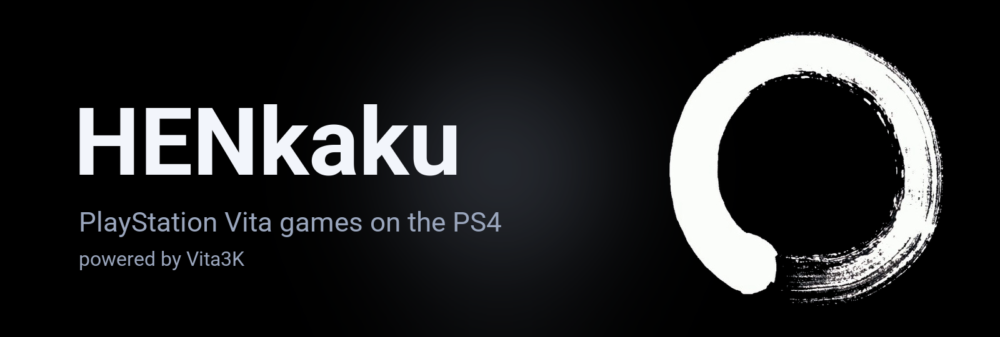

  

  
  
  
  

<h3 align="center">PlayStation Vita games on the PS4.</h3>

  <a href="https://github.com/iHaiDeeZ/HENkaku-PS4/releases/latest"><b>⬇ Get the latest release</b></a> ·
  <a href="#getting-started">Getting started</a> ·
  <a href="#pkgj">PKGj</a> ·
  <a href="#controls">Controls</a> ·
  <a href="#the-henkaku-menu">HENkaku menu</a> ·
  <a href="#performance">Performance</a> ·
  <a href="#faq">FAQ</a> ·
  <a href="CREDITS.md">Credits</a>

---

## Overview

HENkaku brings [Vita3K](https://github.com/Vita3K/Vita3K), the PlayStation Vita emulator, to jailbroken PS4
consoles. The Vita's ARM code runs on the PS4's CPU through the dynarmic JIT, and its GXM graphics through Vita3K's
Vulkan renderer on Mesa's RADV driver, ported to submit work straight to the PS4's AMD GPU.

It installs as an app on the home screen and opens on a home screen like the Vita's own: bubbles, each game's
LiveArea, and the firmware's Settings, Content Manager and Trophy Collection. Games install from the PS4's storage,
a USB drive or PKGj, and **L3 + R3** opens the HENkaku menu while you play.

You bring your own games: no games, firmware or other Sony files are in this repository or its releases. HENkaku
downloads the PS Vita firmware from Sony's own update server the first time it starts.

## Highlights

**A PS Vita on your PS4**
- The Vita's home screen: bubbles in pages of ten, each game's LiveArea, drawn with the installed firmware's own
  pictures.
- The firmware's apps: Settings opens HENkaku's settings, Content Manager installs games, and Trophy Collection
  shows each game's trophies with their pictures, grades and dates.
- Your games, saves and trophies stay in `/data/HENkaku` across updates.

**Installing games**
- `.vpk` and `.zip` archives, dumped game folders, `.pkg` files with their zRIF or license, and NoNpDrm dumps,
  decrypted in place.
- From `/data/HENkaku/install` (copy them over FTP), anywhere on the PS4's storage, or a USB drive.
- PKGj works as on a Vita with NoNpDrm: its downloads come down in the background and install by themselves.

**More games**
- Since 1.14 HENkaku carries the game fixes of [Vita3K+](https://github.com/nckstwrt/Vita3K-Plus) by nckstwrt:
  graphics, shader, sound, video and system fixes for Killzone, Resistance, Need for Speed, Call of Duty, Gundam
  Breaker 3, Tearaway, LittleBigPlanet, Uncharted's camera and many more. Its thread scheduler and Android memory
  modes are not included: HENkaku keeps its own (HENkaku > CPU > Vita core threads).

**Made for the PS4**
- FidelityFX Super Resolution 1 upscales the Vita's picture to 1080p, with adjustable sharpness.
- Frame generation shows a made frame between every two of a game's under 50 fps, so the screen changes every
  vblank.
- The FPS hack, for games that can run at 60 instead of 30.
- Every setting for all games, or for one game only.

**Controls your way**
- Any DualShock 4 button can be any Vita button, a PS TV button, or a touch at one of nine places of the front
  screen or the rear touch pad. The touch pad is the front screen, the rear pad, or both.

**When something goes wrong**
- Logs, a crash report and the last game's own log in `/data/HENkaku`, and profilers in HENkaku > Diagnostics,
  each with its own off switch.

## Getting started

**You need:** a jailbroken PS4 with **GoldHEN**, an FTP connection to it, an internet connection on the PS4 the
first time (or Sony's update files), and your own PS Vita games.

1. Download **`HENkaku-vXX.XX.pkg`** from the [releases page](https://github.com/iHaiDeeZ/HENkaku-PS4/releases/latest),
   copy it to the PS4 (for example to `/data/pkg` over FTP), install it with GoldHEN's **Package Installer** and
   start **HENkaku** from the home screen.
2. The first time, HENkaku downloads the PS Vita firmware (3.74, 128 MB) and its font package (54 MB) from Sony's
   update server and installs them. **Circle** stops the download and **Square** starts it again. Without a
   connection, copy Sony's update files (`PSVUPDAT.PUP`, `PSP2UPDAT.PUP`) to `/data/HENkaku/install/` and install
   them like a game.
3. Copy your games to **`/data/HENkaku/install/`** over FTP, anywhere else under `/data`, or onto a USB drive.
4. On the home screen, open **Install** (or press **Triangle**). **Cross** installs the file you picked (or opens a
   folder), **Square** installs everything in the folder, and **Circle** goes up to the list of places. What
   installs from the install folder moves to `install/done/`.
5. The game you just installed is picked: **Cross** opens its LiveArea, and **Cross** again starts it.

### The firmware and fonts by hand

HENkaku downloads both from Sony the first time it starts. Without an internet connection on the PS4, or when the
download keeps failing, download them on a PC and install them yourself:

1. Download Sony's two update files (keep their names):
   - **PS Vita firmware 3.74**: [PSVUPDAT.PUP](http://dus01.psv.update.playstation.net/update/psv/image/2022_0209/rel_f2c7b12fe85496ec88a0391b514d6e3b/PSVUPDAT.PUP?dest=us),
     133,834,240 bytes
   - **PS Vita font package**: [PSP2UPDAT.PUP](http://dus01.psp2.update.playstation.net/update/psp2/image/2019_0924/sd_8b5f60b56c3da8365b973dba570c53a5/PSP2UPDAT.PUP?dest=us),
     56,768,512 bytes

   They come from Sony's own update server, which only offers plain HTTP: if your browser warns about that,
   keep the file. A file of another size didn't download completely.
2. Copy both to **`/data/HENkaku/install/`** on the PS4 over FTP (or onto a USB drive).
3. Start HENkaku and press **Triangle** (or open **Install**): **Square** installs both, or pick one and press
   **Cross**. Each moves to `install/done/` once it's in.
4. With both in, the home screen no longer says the firmware is missing, and games start.

**What installs:** `.vpk` and `.zip` archives; dumped game folders (with `sce_sys/param.sfo`); `.pkg` files with a
`.zrif` text file of the same name holding the zRIF (or their `.rif` license installed first); NoNpDrm dumps (with
`sce_sys/package/work.bin`). A NoNpDrm dump copied straight into `/data/HENkaku/fs/ux0/app/` is decrypted in place
the first time it starts.

**Updating HENkaku:** install the newer package on top of the old one. Your games, saves and settings stay.

**Coming from v00.xx?** Those versions kept everything in `/data/Vita3K`. 1.00 moves that folder to
`/data/HENkaku` the first time it starts, with your games, saves and settings in it.

## The home screen

| Button | |
|---|---|
| D-pad, left stick | Move between bubbles |
| L1 / R1 | A page up or down |
| Cross | Open: a game's LiveArea (Cross again starts it), the HENkaku bubble's settings, Install |
| Square | The game's own settings; on the HENkaku bubble, **Themes** |
| Triangle | Install games |
| OPTIONS | HENkaku's settings (Quit is there too) |

The HENkaku bubble (the ensō) opens the settings of all games.

### Themes

**HENkaku > Themes** (or Square on the HENkaku bubble) changes how the home screen looks:

- **Style**: **Bubbles** (the PS Vita's home screen), **LiveArea cards** (each game's LiveArea as a card, side by
  side: left and right move between them, Cross starts the game, L1 / R1 jump five), or **List** (Vita3K's list).
- **Bubbles**: **3D** (lit like glass, with a gloss and a shadow) or **Flat**.
- **Theme**: ten built-in themes, **Custom colours**, and every **PS Vita theme** you install. Install official
  Vita themes with PKGj, or copy a theme's `.pkg` with its `.zrif` to the install folder; a Vita theme brings its
  own pictures (one per page, scrolling with the pages) and colours.
- **Colours**: pick the background's top and bottom, the light and the focus from 25 colours. Changing one turns
  the theme into Custom colours, starting from the theme you had.
- **Wallpaper**: the theme's own, or a picture: from `/data/HENkaku/wallpapers`, a USB drive (its top folder or a
  `wallpapers` folder on it), or your PS4 screenshots. Each one shows beside the list before you pick it, and a
  picked picture is copied to `/data/HENkaku/wallpapers`.

## PKGj

[PKGj](https://github.com/blastrock/pkgj) works as on a Vita with NoNpDrm. Install its `.vpk` like any game, then
use **Install game** as usual:

- The package comes down while PKGj runs (the bottom right corner shows how far along it is), carries on in
  HENkaku's home screen when you go back to it, and installs there with the license PKGj gave. The new game's
  bubble is picked.
- **Circle** stops a download; HENkaku's settings (**OPTIONS**) > PKGj downloads carries on with it or cancels it.
- Installing needs about twice the package's size of free space for a while: the package is deleted once its
  files are out, and each file is decrypted in place.

## Controls

| DualShock 4 | PS Vita |
|---|---|
| Cross / Circle / Square / Triangle | Cross / Circle / Square / Triangle |
| D-pad, left and right sticks | D-pad, left and right sticks |
| L1 / R1 | L / R |
| OPTIONS | START |
| Touch pad click | SELECT |
| Touch pad | A pointer on the front touch screen: tap to touch |
| L2 / R2 | Rear touch pad, left / right |
| L3 / R3 | Front touch screen, two places |
| **L3 + R3** | **The HENkaku menu** |

Change them for all games in HENkaku > Controls, or for one game in its own settings or in the HENkaku menu. Any
DualShock 4 button can be any Vita button, a PS TV button, a touch at one of nine places of the front screen or the
rear touch pad, or nothing. **Sticks** sets their range: **Square** (the default) makes a full diagonal full on both
axes, as on the PS2's and PS3's pads the games were made for (Ratchet & Clank needs it for diagonals); **Round** gives
the DualShock 4's own range.

The touch pad has two modes (**Touch pad**, for all games or one, also in the HENkaku menu's Controls):

- **Hover** (the default): your finger moves a pointer as on a laptop's touch pad (lifting it leaves the pointer
  where it is), a **tap** touches the screen there, and a tap then your finger down again and moving drags a touch
  (a swipe). A ring shows the pointer, filled while it touches.
- **Direct**: the touch pad is the screen itself: where you touch is where it touches, with two fingers too.

The rings can be turned off in HENkaku > Display > Touch markers.

When a game asks you to type something (a name, a save's title, a search), the **PS4's own keyboard** opens with
the game's title and text. Type with the DualShock 4 (Cross picks a key) or a USB or Bluetooth keyboard, then
choose Done: the text goes to the game. Closing the keyboard cancels, or keeps the text the game started with if
the game gives no way to cancel.

The DualShock 4's **motion sensors** are the Vita's: tilting and turning the controller tilts and turns the Vita
for games that use motion (aiming, balancing, steering).

The Vita's **cameras** (Controls > Camera, for all games or one, also in the HENkaku menu):

- **PS4 camera** (the default): a PlayStation Camera on the PS4 shows what it sees. Without one, the game sees
  your picture (below), or grey.
- **Picture**: a picture of your own: put it in `/data/HENkaku/camera.png` or `/data/HENkaku/camera.jpg`.
- **Dark** or **Bright**: a solid colour. Bright passes puzzles that want light on the camera (Uncharted: Golden
  Abyss, chapter 13).

## The HENkaku menu

Press **L3 + R3** while playing. The game pauses under the menu; **Resume** goes back to it and **Exit** to the
home screen.

| Page | What's in it | Applies |
|---|---|---|
| Display | Show FPS and where, screen filter (FSR 1, bilinear, ...), FSR sharpness, frame generation, texture filtering | At once |
| Audio | Volume | At once |
| Speed | Shader compiling (in the background or before drawing), the FPS hack, the frame queue | At once |
| Controls | This game's buttons and touches | At once |
| This game | The game's own settings: resolution, accuracy and the rest | Next start |
| Diagnostics, About | Profilers and logs, each with an off switch; the version | |

"Next start" settings apply when the game starts again: HENkaku goes back to its home screen after every game, so
**Exit** and start it again.

## Performance

The PS4's CPU is the limit: the Vita's code is translated on the fly and its graphics turned into Vulkan on the
same eight 1.6 GHz Jaguar cores. Lighter games run at full speed; heavier 3D games run at 30 fps or a little
under, as some did on the Vita itself.

Games played on the console so far include Mortal Kombat, God of War Collection, Uncharted: Golden Abyss, Ninja
Gaiden Sigma 2 Plus and Persona 4 Golden. Vita3K's [compatibility list](https://vita3k.org/compatibility.html) is a
good guide: a game that doesn't work in Vita3K won't work here either.

- **Frame generation** (Display): for games under 50 fps, a frame made between every two of the game's, placed at
  its moment, so motion looks smoother. Fast camera moves can still show some smearing at the edges of moving
  things. It's off by default.
- **FPS hack** (Speed): lets a game that waits two vblanks per frame wait one. Some games run at 60 with it; in
  games whose speed follows their frame rate it makes them run too fast. It's off by default.
- **FSR 1** (Display, screen filter): upscales the Vita's 960x544 picture to the TV with a sharpening pass.
- **Fast system calls** (HENkaku > CPU): calls that never wait (the thread's ID and storage, the clocks, the
  graphics state setters and draws) run inside the translated code instead of stopping it, and the thread's ID and
  storage are answered by a few instructions in the game's own code. Some games make hundreds of thousands a
  second. It's on by default and applies when a game starts.
- **Fast atomics** (HENkaku > CPU): a game's atomic operations (its locks, counters and queues) run as one host
  instruction each, without a lock shared by all of its threads. They differ from the Vita only in a case games
  rarely depend on. It's on by default and applies when a game starts; turn it off if a game hangs or crashes
  where it didn't before.
- **Vita core threads** (HENkaku > CPU): **One at a time** (the default) runs the threads a game puts on one Vita
  core one at a time, as the Vita does, and a thread of a higher priority takes the core at once; some games
  deadlock otherwise. **Side by side** lets them all run at the same time; try it if a game hitches.
- **Ordered blending** (HENkaku > Graphics): draws that blend with what's already on screen are drawn one triangle
  at a time. That's exact where triangles overlap, but much slower on the PS4's GPU. It's off by default; turn it on
  if you see flickering specks in smoke or water effects.

## Your files

Everything lives in **`/data/HENkaku/`**:

- `install/`: what you copy there to install; `done/` afterwards
- `fs/`: the Vita's storage: `ux0` (your games, saves, PKGj), the firmware in `vs0`, `os0`, `sa0` and `pd0`
- `config.yml`, `config/`: Vita3K's settings, for all games and for each game
- `ps4.cfg`, `controls/`, `wallpapers/`: HENkaku's own settings, controls and wallpaper pictures
- `cache/`: shaders and pipelines, made again when missing
- `vita3k.log`, `vita3k.prev.log`, `vita3k.game.log`, `boot-trace.log`, `crash.log`: logs for bug reports

## FAQ

**Where do I get games?**
From your own PS Vita: dump the games you own with NoNpDrm or a similar tool. This project won't help you find
games.

**Why isn't the firmware in the package?**
It's Sony's. HENkaku downloads it from Sony's own update server, as Vita3K does on a PC.

**Why does HENkaku start over after every game?**
A game leaves threads, memory and the GPU in use when it ends. Starting over is the clean way back to the home
screen; it takes a few seconds.

**PKGj says "database disk image is malformed".**
Versions before 1.00 could lose the last write to a file a game still had open, which left PKGj's comp pack
databases broken. 1.00 fixes the cause. Delete `comppack.db` and `comppack_updates.db` from
`/data/HENkaku/fs/ux0/pkgj/` once, and PKGj makes them again.

**A game doesn't start, or crashes.**
Check Vita3K's compatibility list first. Then [open an issue](https://github.com/iHaiDeeZ/HENkaku-PS4/issues) with
`vita3k.game.log` (or `vita3k.prev.log`), `boot-trace.log` and `crash.log` from `/data/HENkaku/`, the HENkaku
version, the game's title ID, and your PS4 model and firmware. Never attach game files.

## Good to know

- HENkaku is Vita3K with PS4 changes: what works in Vita3K generally works here, at the PS4 CPU's speed.
- The first time a game draws something new, its shaders are compiled in the background, so an object can appear
  a frame late. They're kept for next time.
- PS4 Pro reports are welcome.
- How the port works, and what changed in each version up to 1.00: **[docs/PORT.md](docs/PORT.md)**. Building it:
  **[docs/BUILDING.md](docs/BUILDING.md)**.

## Thanks

- **[Vita3K](https://github.com/Vita3K/Vita3K)** and its team: the emulator, everything that runs the games
- **[Vita3K+](https://github.com/nckstwrt/Vita3K-Plus)** by nckstwrt (with work from NaGaa95's vita-nx and others):
  the game compatibility fixes merged in 1.14
- **[dynarmic](https://github.com/Vita3K/dynarmic)**: the ARM JIT
- **[Mesa](https://mesa3d.org)**: the RADV Vulkan driver that draws every frame
- **[OpenOrbis](https://github.com/OpenOrbis)** and **[PacBrew](https://github.com/PacBrew)**: the PS4 toolchains
- **[AMD FidelityFX](https://gpuopen.com/fidelityfx-superresolution/)**: FSR 1
- **team molecule** and **[HENkaku](https://henkaku.xyz)**, the PS Vita hack whose name and ensō this app carries

Everyone involved, with licences, is listed in **[CREDITS.md](CREDITS.md)**.

## License and disclaimer

Released under the **GNU General Public License v2.0 or later**, as Vita3K. See [LICENSE](LICENSE). The PS4 runtime
pieces come from [Resonance](https://github.com/iHaiDeeZ/Resonance), [DolphinPS4](https://github.com/iHaiDeeZ/DolphinPS4),
[M33](https://github.com/iHaiDeeZ/M33) and [Crema](https://github.com/iHaiDeeZ/Crema). HENkaku for the PS4 is made
by **iHaiDeeZ / ShiroKlein**.

This is a fan-made project with no ties to Sony Interactive Entertainment, the Vita3K team or team molecule.
PlayStation, PS Vita and PS4 are trademarks of Sony Interactive Entertainment. Please only play games you own. This
project won't help you find or share games, firmware or keys.
